<div align="center">

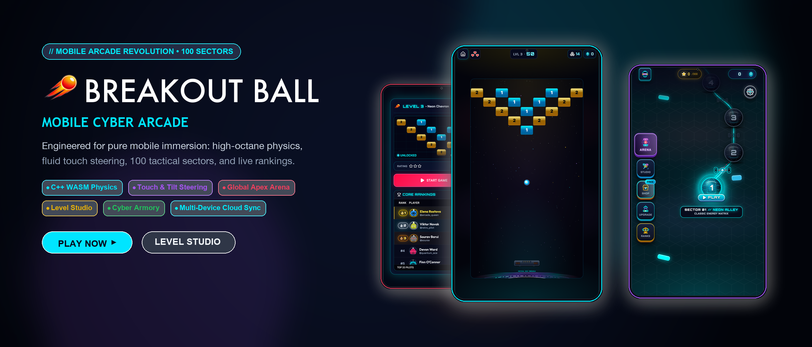

# ⚡ BREAKOUT BALL — CYBER ARCADE REIMAGINED

<p align="center">
  <strong>A high-octane, next-generation brick breaker engineered with C++ WebAssembly, WebGL 2 particle shaders, 100 tactical sectors, an in-browser level creator studio, live global arena rankings, and full cross-device synchronization.</strong>
</p>

<p align="center">
  <a href="https://breakout.elsesourav.com"></a>
  <a href="https://elsesourav.com/apps/breakout-ball"></a>
  <a href="https://elsesourav.com/updates"></a>
</p>

<p align="center">
  
  
  
  
  
  
  
</p>

</div>

---

## 🎯 ElseSourav App Submission Manifest

All required media assets have been generated to the exact aspect ratio, dimension, and folder specifications established by the **ElseSourav Platform** (`elsesourav.com`):

| Target Form Field | Asset Path | Aspect Ratio | Dimensions | Format | Usage Context |
| :--- | :--- | :---: | :---: | :---: | :--- |
| **App Icon** (`iconUrl`) | [`showcase/app-icons/app-icon-512x512.png`](./showcase/app-icons/app-icon-512x512.png) | **1:1** | `512 × 512` | PNG (Alpha) | App Store icon, header badge, crisp retina branding |
| **App Icon Night** | [`showcase/app-icons/app-icon-night-512x512.png`](./showcase/app-icons/app-icon-night-512x512.png) | **1:1** | `512 × 512` | PNG | Mobile PWA home screen icon, Android adaptive badge |
| **Vector Mark** | [`showcase/app-icons/app-icon.svg`](./showcase/app-icons/app-icon.svg) | **1:1** | Scalable | SVG | Infinite resolution vector branding mark |
| **Carousel Desktop** (`desktopImageUrl`) | [`showcase/banners/carousel-slider-desktop-21x9.png`](./showcase/banners/carousel-slider-desktop-21x9.png) | **21:9** | `2520 × 1080` | PNG | ElseSourav homepage featured hero carousel slider |
| **Carousel Mobile** (`mobileImageUrl`) | [`showcase/banners/carousel-slider-mobile-3x4.png`](./showcase/banners/carousel-slider-mobile-3x4.png) | **3:4** | `1200 × 1600` | PNG | ElseSourav mobile hero carousel card |
| **Landscape Cover** (`featuredImageUrl`) | [`showcase/banners/app-cover-landscape-16x9.png`](./showcase/banners/app-cover-landscape-16x9.png) | **16:9** | `1600 × 900` | PNG | ElseSourav `/apps/breakout-ball` main desktop cover |
| **Portrait Cover** (`featuredImageMobileUrl`) | [`showcase/banners/app-cover-portrait-3x4.png`](./showcase/banners/app-cover-portrait-3x4.png) | **3:4** | `1200 × 1600` | PNG | ElseSourav mobile app details card & catalog preview |
| **Devlog / Update Banner** (`coverImageUrl`) | [`showcase/banners/update-banner-v2-16x9.png`](./showcase/banners/update-banner-v2-16x9.png) | **16:9** | `1600 × 900` | PNG | ElseSourav `/updates` devlog post: *"Version 2.0 Overhaul"* |
| **Desktop Screenshots** (`screenshots[]`) | [`showcase/screenshots/desktop-*.png`](./showcase/screenshots/) | **16:9** | `3840 × 2160` | PNG (4K) | High-definition app gallery previews (5 screens) |
| **Mobile Screenshots** (`screenshots[]`) | [`showcase/screenshots/mobile-*.png`](./showcase/screenshots/) | **9:16** | `860 × 1864` | PNG (Retina) | Mobile experience showcase gallery (7 screens) |
| **Animated Previews** | [`showcase/gifs/*.gif`](./showcase/gifs/) | Dynamic | Optimized | GIF | Live gameplay action, level studio, and map navigation |

---

## 🎬 Live Animated Feature Previews

<table>
  <tr>
    <td width="33%" align="center">
      <h4>⚡ Real-Time WASM Physics</h4>
      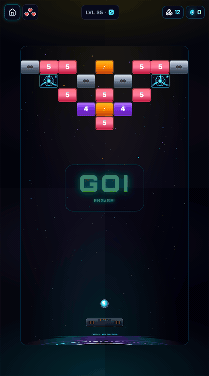
      <p><em>Sub-millisecond AABB collision detection, dynamic particle trails, and smooth 120 FPS response.</em></p>
    </td>
    <td width="33%" align="center">
      <h4>🛠️ Level Creator Studio</h4>
      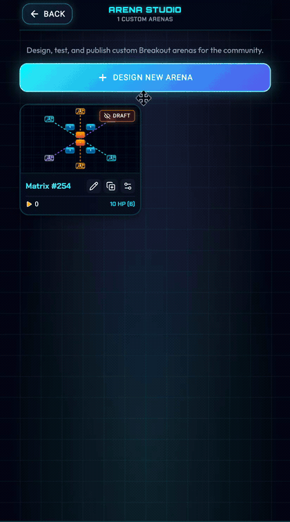
      <p><em>Full drag-and-drop brick designer, 12+ block archetypes, and instant cloud sharing.</em></p>
    </td>
    <td width="33%" align="center">
      <h4>🪐 100-Sector Campaign Map</h4>
      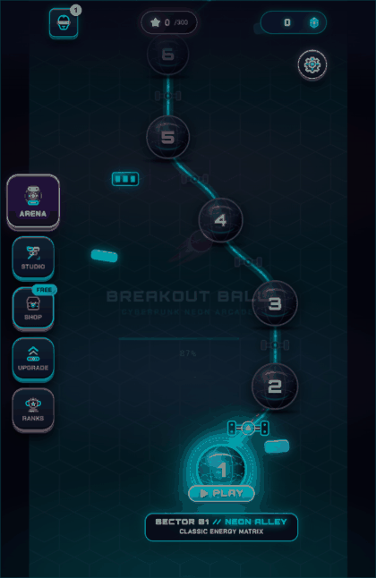
      <p><em>Cosmic progression across 10 themed sectors, level ratings, and glowing path lines.</em></p>
    </td>
  </tr>
</table>

---

## 📸 Desktop Showcase Gallery (16:9 4K)

<table width="100%">
  <tr>
    <td width="50%">
      <p align="center"><strong>Sector Campaign Map & Sector Selection</strong></p>
      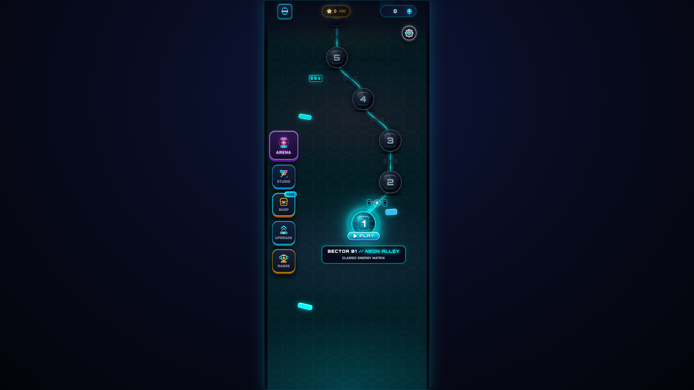
    </td>
    <td width="50%">
      <p align="center"><strong>High-Octane Gameplay & WASM Physics</strong></p>
      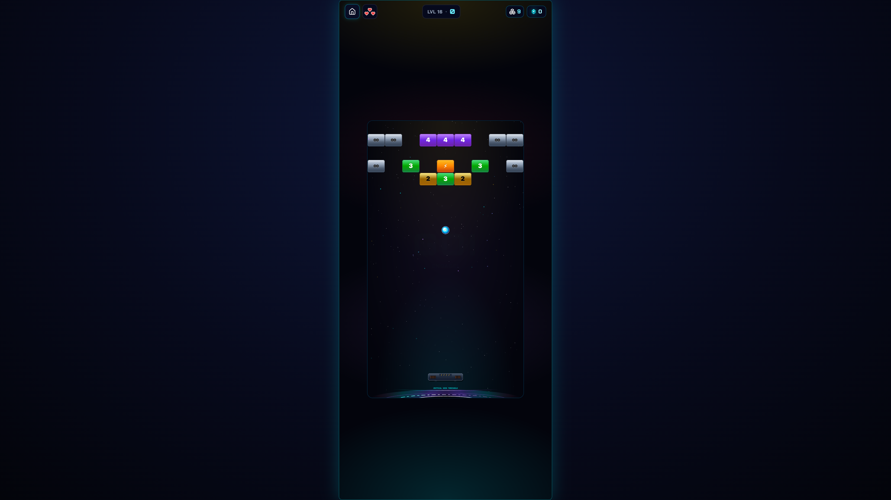
    </td>
  </tr>
  <tr>
    <td width="50%">
      <p align="center"><strong>Level Studio & Block Matrix Forge</strong></p>
      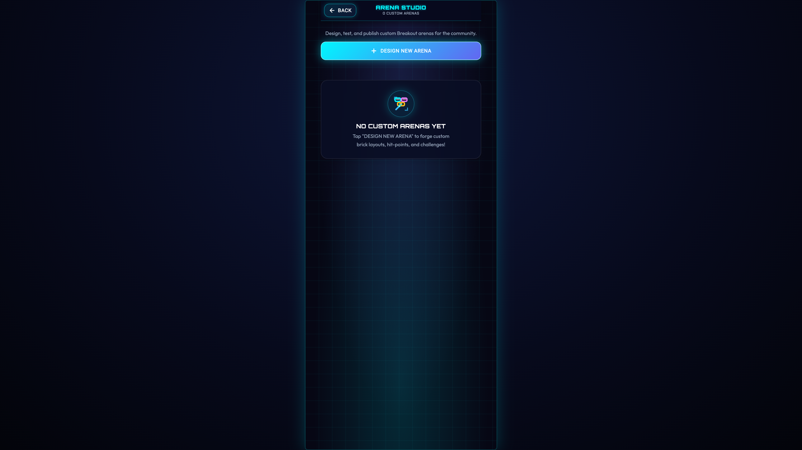
    </td>
    <td width="50%">
      <p align="center"><strong>Global Apex Leaderboard & Speedruns</strong></p>
      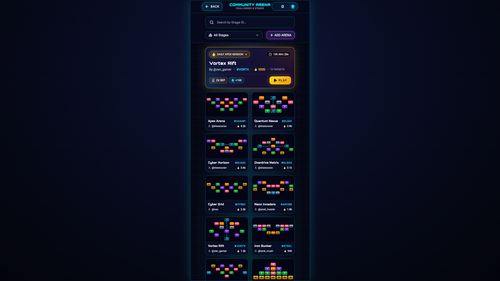
    </td>
  </tr>
  <tr>
    <td colspan="2" align="center">
      <p align="center"><strong>Cyber Armory & Cosmetics Depot</strong></p>
      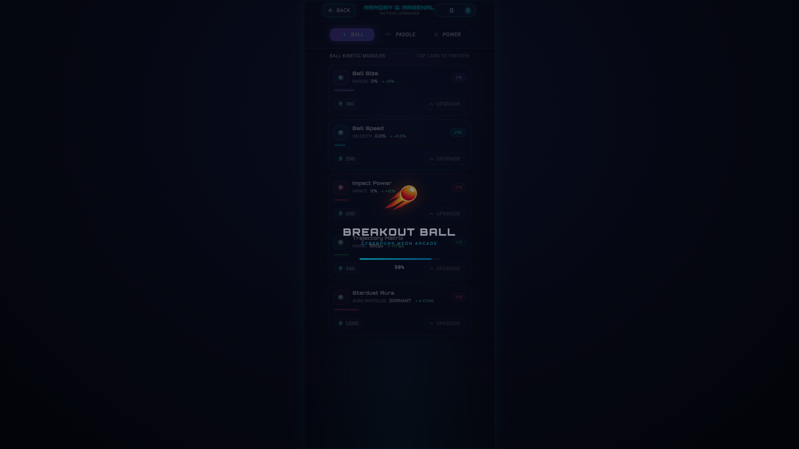
    </td>
  </tr>
</table>

---

## 📱 Mobile Experience Showcase (9:16 Retina)

<p align="center">
  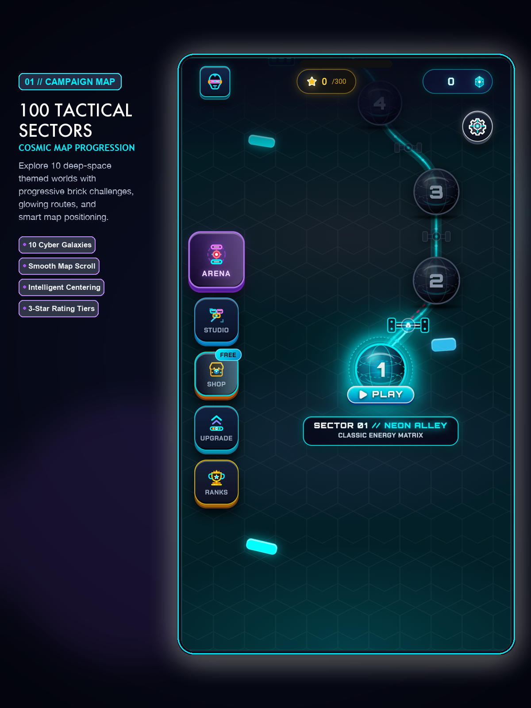
  &nbsp;
  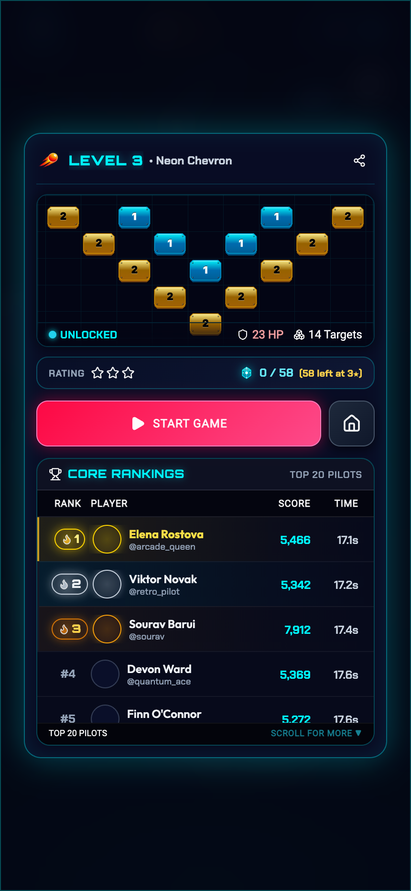
  &nbsp;
  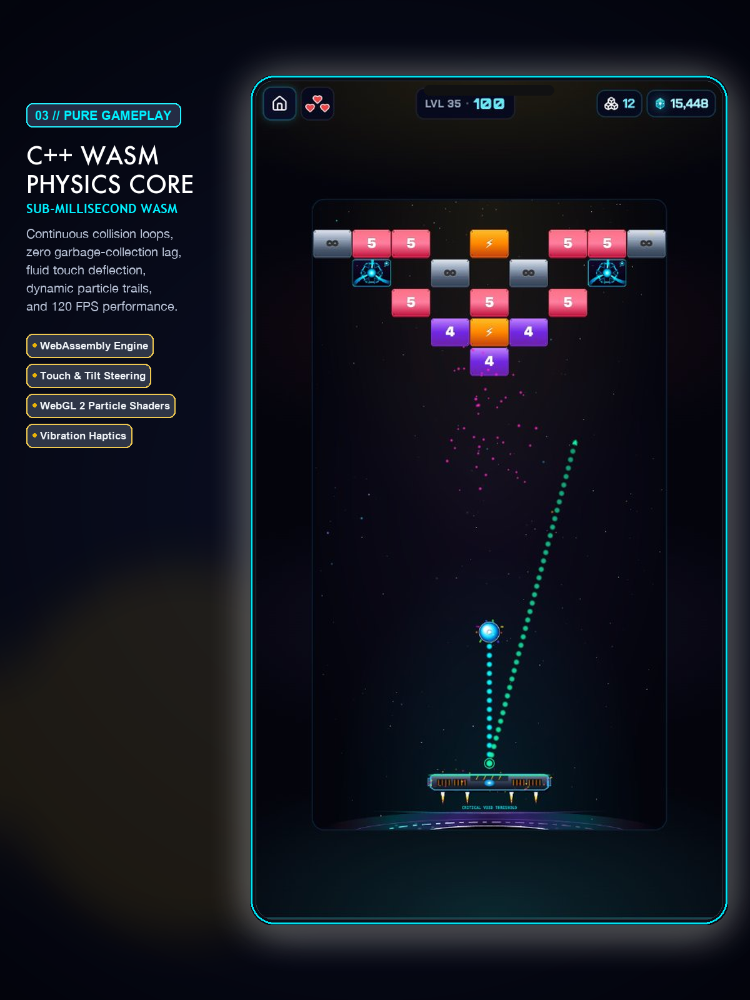
  &nbsp;
  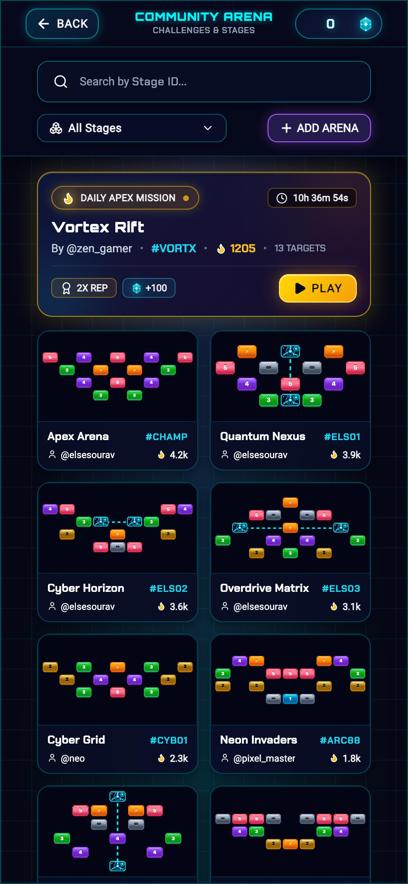
  &nbsp;
  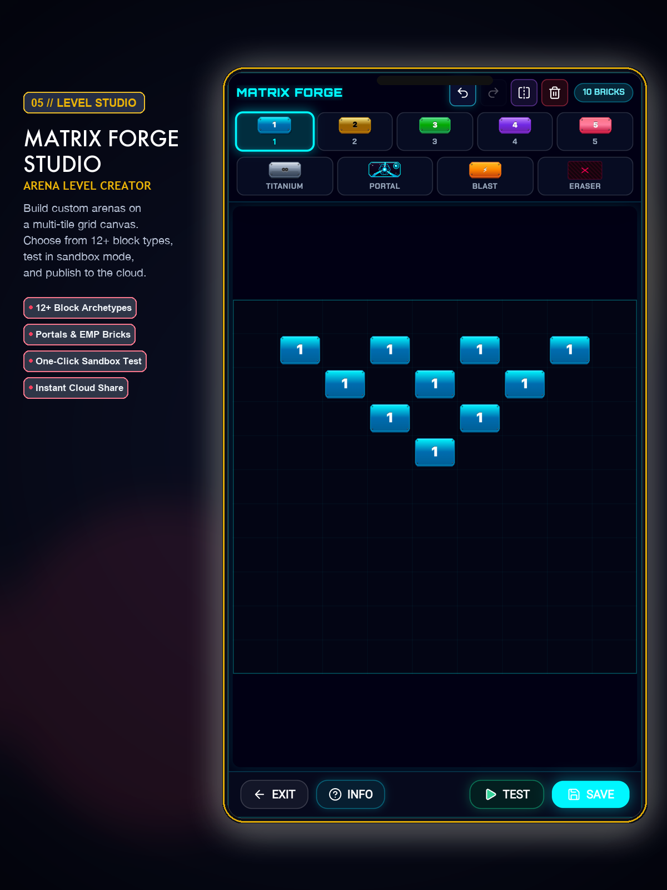
  &nbsp;
  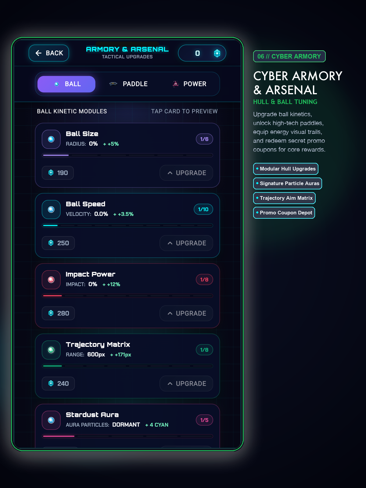
  &nbsp;
  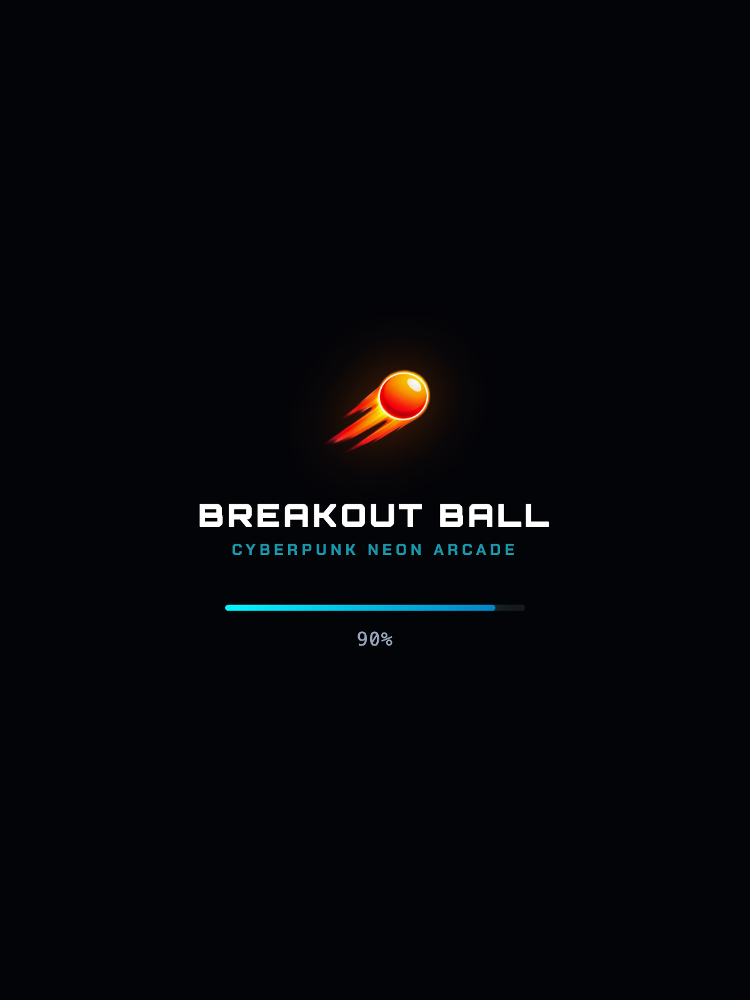
</p>

---

## 🚀 Key Features

### 1. ⚡ Deterministic C++ WebAssembly Physics Engine
- **Microsecond Collision Loops**: Continuous collision integration that completely eliminates "tunneling" at high ball velocities.
- **Spin Dynamics & Angle Deflection**: Dynamic launch trajectories calculated from paddle contact velocity and offset vectors.
- **Zero-GC Stutter**: Pre-allocated memory structures maintain perfectly fluid 60/120 FPS frame rates without garbage collection hiccups.

### 2. 🪐 100 Campaign Sectors Across 10 Themed Cyber Worlds
- **10 Distinct Worlds**: Neo-Tokyo, Quantum Core, Neon Cyberpunk, Bio-Hazard, Molten Core, Deep Abyss, Solaris Flare, Chrono Glitch, Celestial Void, and Omega Singularity.
- **Progressive Mechanics**: Unbreakable shielding, EMP pulse generators, quantum warp portals, health-scaled armor bricks, multi-ball clusters, and explosive chain reactions.
- **Intelligent Map Positioning**: Automatically restores and scrolls to the player's active campaign sector upon loading or returning from victory.

### 3. 🛠️ In-Browser Level Designer Studio
- **Matrix Grid Canvas**: Full interactive editor with multi-tile brushes, fill tools, eraser, and color pickers.
- **12+ Block Types**: Normal, Reinforced, Steel, Explosive, Multi-Ball, EMP, Laser, Portal, and Shield blocks.
- **Instant Cloud Publishing**: Test any level in a sandbox emulator and publish it to the community gallery with one click.

### 4. 🌐 Real-Time Apex Global Arena
- **Live Leaderboard**: Cross-device global rankings with microsecond speedrun timers and 3-star rating tiers.
- **Daily Apex Challenges**: Automated daily competition seeds with exclusive leaderboard trophies.
- **Robust Cloud API**: High-availability Fastify + Supabase backend hosted at `https://api-breakout.elsesourav.com`.

### 5. 🛡️ Cyber Armory & Visual Customizations
- **Signature Paddles**: Equip high-tech hulls like the *Valkyrie Horizon*, *Quantum Strike*, and *Obsidian Aegis*.
- **Energy Balls & VFX**: Choose between *Plasma Core*, *Solar Flare*, *Inferno*, and *Cosmic Void* ball trails.
- **Coupon & Promo Engine**: Redeem promotional codes for exclusive cyber cosmetics and core currency.

### 6. 🎮 Universal Multi-Input Controls
- **Touch & Swipe**: Ultra-responsive fluid touch controls tailored for mobile browsers and PWA.
- **Keyboard & Mouse**: Arrow keys, A/D, and smooth mouse paddle tracking with aiming guideline projection.
- **Gyroscope Tilt & Gamepad API**: Real hardware tilt navigation and analog gamepad support with haptic vibration feedback.

### 7. 🔐 Seamless OAuth & Cross-Tab Multi-Window Sync
- **Google & GitHub SSO**: Native OAuth popup support on desktop and mobile web with automatic cross-tab state propagation via `BroadcastChannel` and storage synchronization.
- **Encrypted Local Fallback**: Full offline play support with automatic sync upon reconnecting.

---

## 📂 Project Architecture

```
breakout-ball/
├── public/                     # Static icons, manifest, sounds, favicon
│   ├── favicon.svg             # Crisp vector fireball icon
│   ├── icon-breakout-clean.png # Master transparent icon
│   └── site.webmanifest        # PWA configuration
├── showcase/                   # ElseSourav Platform Media Showcase
│   ├── app-icons/              # 1:1 Icons (512x512 Transparent, Night, SVG)
│   ├── banners/                # ElseSourav Banners (21:9 Slider, 16:9 Cover, 3:4 Portrait, Updates)
│   ├── gifs/                   # Live Gameplay & Studio animated GIFs
│   └── screenshots/            # 4K Desktop (16:9) & Retina Mobile (9:16) screenshots
├── scripts/                    # Generation & Verification Automation
│   ├── capture_live_screenshots.mjs # Headless Chrome screenshot automation
│   ├── capture_live_gifs.mjs   # Headless Chrome frame capture automation
│   ├── compile_gifs.py         # Pillow GIF compiler & optimizer
│   └── generate_showcase_assets.py # ElseSourav banner compositing pipeline
├── server/                     # Fastify Cloud API server
├── src/                        # Game client (all files strictly < 500 lines)
│   ├── audio/                  # Web Audio synthesizer & sound manager
│   ├── components/             # React modular UI components
│   │   ├── arena/              # Global Arena & leaderboards
│   │   ├── armory/             # Cyber Armory & cosmetics depot
│   │   ├── game/               # Canvas game renderer, HUD, countdown
│   │   ├── roadmap/            # 100-sector campaign map
│   │   └── studio/             # Level designer & editor tools
│   ├── hooks/                  # Custom React hooks (gamepad, audio, viewport)
│   ├── levels/                 # 100 sector level definitions & themes
│   ├── physics/                # C++ WASM bindings and collision logic
│   └── services/               # Supabase Auth, Backend API, and Cloud Sync
└── index.html                  # PWA bootstrap & SEO metadata
```

---

## 🛠️ Local Development & Setup

### Prerequisites
- **Node.js** >= 18.0.0
- **npm** or **pnpm**
- **Python 3** (with `Pillow` and `numpy` for asset generation scripts)

### Installation
```bash
# Clone the repository
git clone https://github.com/elsesourav/breakout-ball.git
cd breakout-ball

# Install dependencies
npm install

# Start Vite local development server
npm run dev
```
Open [http://localhost:5173](http://localhost:5173) in your browser.

### Building for Production
```bash
# Typecheck and build production bundle
npm run build

# Preview production build locally
npm run preview
```

### Running Backend API (Optional)
```bash
# Start local Fastify API server (port 4000)
npm run server
```
*Note: The client automatically defaults to the production cloud API at `https://api-breakout.elsesourav.com` when running locally without a custom backend.*

### Regenerating Showcase Assets
```bash
# 1. Capture 4K desktop and retina mobile screenshots
node scripts/capture_live_screenshots.mjs

# 2. Capture animated gameplay frames and compile GIFs
node scripts/capture_live_gifs.mjs
python3 scripts/compile_gifs.py

# 3. Generate all ElseSourav banners, covers, and app icons
python3 scripts/generate_showcase_assets.py
```

---

## 👨‍💻 Author & Connect

**Sourav (ElseSourav)**
- 🌐 **Platform**: [elsesourav.com](https://elsesourav.com)
- 🚀 **App Hub**: [elsesourav.com/apps/breakout-ball](https://elsesourav.com/apps/breakout-ball)
- 💼 **LinkedIn**: [linkedin.com/in/elsesourav](https://linkedin.com/in/elsesourav)
- 🐦 **Twitter / X**: [@elsesourav](https://twitter.com/elsesourav)
- 🐙 **GitHub**: [@elsesourav](https://github.com/elsesourav)

---

## 📄 License

This project is open-source and released under the [MIT License](./MIT-LICENSE.txt).
